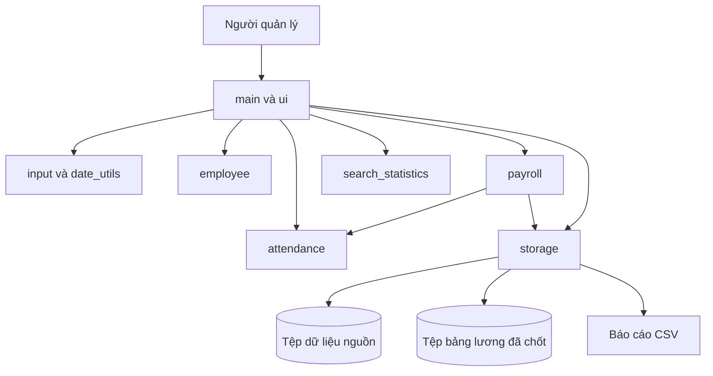
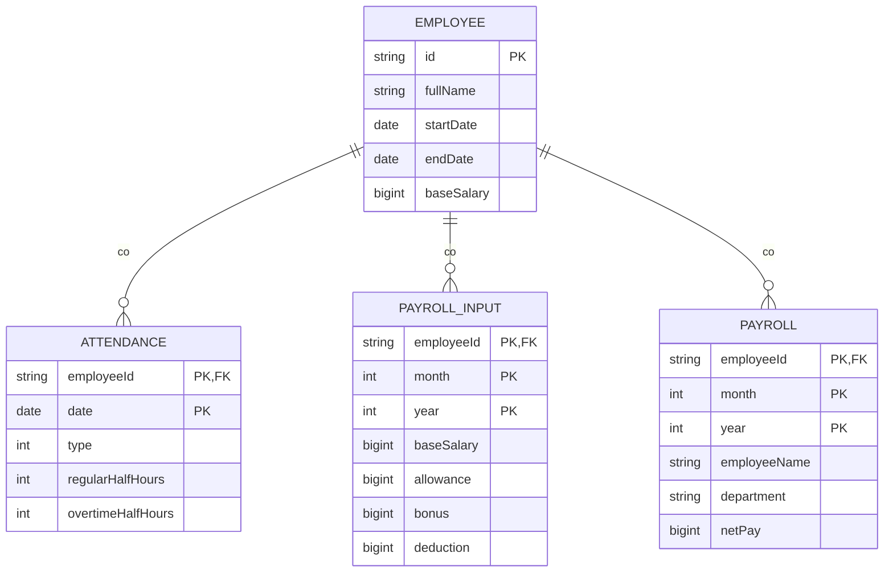
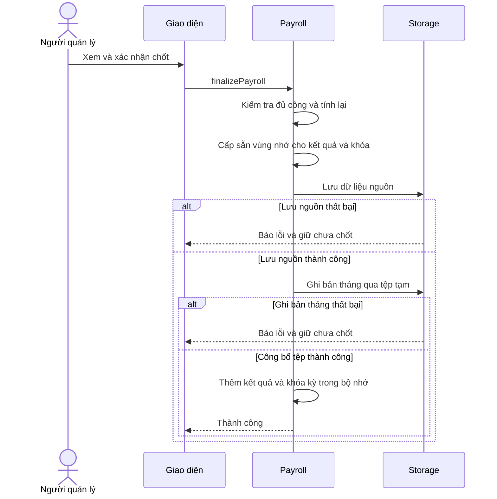

# Thiết kế kỹ thuật của bản triển khai

Phiên bản 1.2 ngày 05/11/2026. Tài liệu này bổ sung cho ba tài liệu chuyển từ DOCX, ghi đúng cách tổ chức mã nguồn hiện tại. Các giả định nghiệp vụ của URD tiếp tục được áp dụng.

## Kiến trúc

`models.h` định nghĩa dữ liệu dùng chung. `AppData` sở hữu danh sách liên kết đơn nhân viên và các mảng công, lương. Mỗi nút nhân viên được cấp bằng malloc, giải phóng trong appFree. Mảng công, thông số và kết quả lịch sử tăng dung lượng qua reserveArray. Giới hạn nhân viên vẫn là 200. EmployeeNode chứa Employee và next; employeeHead trỏ tới nút đầu.

## Quan hệ dữ liệu

Các khóa được chương trình kiểm tra, không có hệ quản trị cơ sở dữ liệu. `MonthLock` là danh sách kỳ có tệp kết quả chính thức hợp lệ, kể cả kỳ không có nhân viên.

## Thành phần và hợp đồng

| Thành phần | Tệp thực tế | Trách nhiệm |
| --- | --- | --- |
| Mô hình | `include/models.h`, `src/models.c` | Kiểu dữ liệu, vùng nhớ, chuẩn hóa mã, UTF-8, hiệu lực nhân viên |
| Ngày | `src/date_utils.c` | Gregorian 2000–2100, ngày nhuận, thứ, lịch công |
| Nhập | `src/input.c` | `fgets`, chống dư dòng, số nguyên, giờ nửa giờ, EOF |
| Nhân viên | `src/employee.c` | Danh sách liên kết thêm/sửa/xóa/tìm; Merge Sort đệ quy; kiểm tra kỳ chốt |
| Công | `src/attendance.c` | Khóa ghép mã/ngày, xác thực công, phát hiện ngày thiếu |
| Lương | `src/payroll.c` | Thông số tháng, tính nguyên đồng, tổng hợp, chốt |
| Lưu trữ | `src/storage.c` | Parser giữ trường rỗng, nạp giao dịch trong bộ nhớ, lưu tạm/sao lưu, CSV |
| Giao diện | `src/ui.c`, `src/ui_display.c`, `src/ui_employee.c`, `src/ui_attendance.c`, `src/ui_payroll.c` | Điều phối menu, hiển thị chung và từng nhóm biểu mẫu |
| Tìm và thống kê | `src/search_statistics.c` | Bộ lọc, tổng hợp, xếp hạng |
| Khởi động | `src/main.c` | Tham số dòng lệnh, nạp dữ liệu, điều phối, mã thoát |

Hàm nghiệp vụ trả `Result`, ghi thông báo cụ thể vào `AppData.error` khi cần. `calculatePayroll` chỉ tính từ đầu vào đã truyền, không đọc bàn phím hoặc ghi tệp.

## Truy vết yêu cầu và màn hình

| Yêu cầu | Màn hình thiết kế | Điểm triển khai | Bằng chứng kiểm thử |
| --- | --- | --- | --- |
| FR01 FR02 | SCR02 SCR03 SCR04 | `employeeMenu`, `employeeForm`, `saveEmployee`, `deleteEmployee` | Trùng mã, sửa, nghỉ, xóa, bảo toàn lịch sử |
| FR03 FR04 | SCR05 SCR06 SCR07 | `attendanceMenu`, `attendanceForm`, `missingAttendance` | Sai lịch, trùng khóa, sửa nửa ngày, thiếu công |
| FR05 | SCR08 | `inputForm`, `savePayrollInput` | Thưởng mới, mức hồ sơ không tự thay tháng |
| FR06 | SCR09 SCR10 SCR11 | `buildPayroll`, `calculatePayroll`, `payrollView` | Ví dụ URD, giữa tháng, phiếu lương |
| FR07 | SCR12 | `finalizePayroll`, `writePayrollSnapshot` | Chốt, mở lại, chặn sửa và chốt lặp |
| FR08 | SCR10 SCR11 SCR13 SCR15 | `searchMenu`, `exportPayroll` | Bộ lọc AND, CSV dấu nháy, không ghi đè CLI |
| FR09 | SCR14 | `statisticsMenu` | Quỹ tạm/chính thức và tổng 26.537.500 |
| FR10 | SCR01 SCR15 SCR16 | `main`, `runConsole`, `loadData`, `saveData` | Lưu mở lại, tệp hỏng, EOF, hủy và bỏ thay đổi |

## Chốt kỳ và kiểm tra tính nhất quán

Khi nạp, dữ liệu được đọc vào `AppData` tạm. Chỉ thay dữ liệu đang dùng khi toàn bộ bước nạp thành công. Công được sắp theo mã/ngày rồi kiểm tra bản liền kề để phát hiện trùng, tránh tìm trùng tuyến tính cho từng dòng khi có 150.000 bản ghi.

Mỗi bản chốt được kiểm tra header, số dòng, khóa, công thức và đối chiếu với dữ liệu công/thông số tháng. Tên và phòng ban sao chép trong bản chốt không cần trùng hồ sơ hiện tại, vì hồ sơ có thể đổi sau khi chốt.

## Độ phức tạp và giới hạn

- Tìm nhân viên: O(E), tối đa 200; duyệt danh sách từ employeeHead.
- employeeAt lấy phần tử thứ k bằng duyệt O(E), không truy cập mảng.
- Merge Sort nhân viên: O(E log E), độ sâu đệ quy O(log E); chỉ nối lại các nút.
- Nạp công và kiểm tra tham chiếu: `O(A × E)`; sắp kiểm tra trùng `O(A log A)`.
- Kiểm tra thiếu theo tháng: `O(A × E + E² + E × 31)` trong cách tra mã hiện tại.
- Tổng hợp lương: `O(A × E + E²)` ngoài kiểm tra thiếu.
- Tìm công riêng lẻ: `O(A)`; phù hợp thao tác từng bản ghi của đồ án.
- Nạp toàn bộ bản chốt có thể quét lại công theo từng kỳ; chưa tối ưu cho kho lịch sử rất lớn.

Nếu phát triển tiếp, có thể thêm chỉ mục mã nhân viên và mã/ngày, tách dữ liệu theo năm, giao dịch nhiều tệp và lịch sử lương theo thời điểm. Các phần này chưa được tính là chức năng đã triển khai.

## Điều chỉnh có chủ đích so với bản phác thảo

- Dùng số trong menu thay một số phím chữ để nhập liệu nhất quán.
- Tìm kiếm và thống kê nằm chung `search_statistics.c`; giao diện được chia thành ui.c điều phối và các tệp ui_display, ui_employee, ui_attendance, ui_payroll.
- Không lưu bảng tạm lâu dài: mỗi lần xem/tính lại đọc nguồn hiện tại. Điều này loại bỏ nguy cơ chốt nhầm bảng tạm đã cũ.
- Thêm giao diện dòng lệnh cho kiểm tra, tính, xuất và chốt; giao diện console tương tác vẫn là chức năng chính.
- Thêm xem đầy đủ hồ sơ tại menu nhân viên mục 6.
- Console hiển thị tiền nguyên đồng, chưa chèn dấu phân cách hàng nghìn.
- Phục hồi tệp là quy trình thủ công có hướng dẫn; chưa có màn hình tự chọn bản sao lưu.

## Thông tin nhóm và kế hoạch

Giữ mẫu thông tin SV1, SV2, SV3 trong ba tài liệu gốc. Kế hoạch phân công 7 giai đoạn, 78 giờ dự kiến/người vẫn là kế hoạch nhóm. Bản triển khai phần mềm được thực hiện trong phiên làm việc này; giờ công kế hoạch không được dùng như nhật ký thực tế.

## Cập nhật theo tiêu chí đánh giá

Bản 1.2 dùng danh sách liên kết đơn cho hồ sơ, đệ quy Merge Sort tại menu nhân viên mục 7, tách các hàm kiểm tra hồ sơ, tên biến rõ nghĩa, ngoặc khối đầy đủ, chú thích tiếng Việt và main điều phối ngắn. Xem tài liệu 06 để có sơ đồ con trỏ, diễn giải đệ quy và câu hỏi bảo vệ. Định dạng tệp và công thức lương giữ tương thích với dữ liệu phiên bản 1.1.
